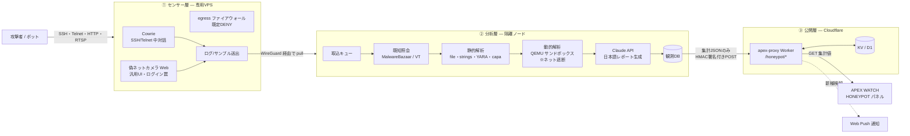

# HACKER HOIHOI — ハニーポット全体設計書

> APEX WATCH 拡張プロジェクト / 設計ドラフト v0.1(2026-10-22)
> ステータス: **設計段階(未実装)** — 第11章「未決事項」の確定後に実装へ進む

---

## 1. 目的とスコープ

### 1.1 目的

初期パスワードのまま放置されたネットワークカメラ等に見せかけた「おとり(ハニーポット)」をインターネット上に設置し、

1. **誰が・どこから・どうやって**侵入を試みるかを継続観測する
2. 攻撃者が**持ち込んだもの**(ダウンロードさせたマルウェア、実行スクリプト、コマンド列)を安全に捕獲する
3. 捕獲物を**自動で分析**し、IOC(侵害指標)・マルウェアファミリ・ATT&CK 対応を日本語レポート化する
4. 集計結果を APEX WATCH のパネルとして**実観測データで可視化**する

という、「観測 → 捕獲 → 分析 → 可視化」までを一貫させた防御目的の脅威観測システムを構築する。

### 1.2 元ネタからの進化ポイント

| 観点 | 一般的なハニーポット実験 | HACKER HOIHOI |
|---|---|---|
| 観測 | アクセス数・試行パスワードの集計 | セッション単位でコマンド列まで再現 |
| 捕獲 | ログのみ | 持ち込まれたファイルを SHA-256 単位で隔離保管 |
| 分析 | 手作業 | 既知照会 → 静的解析 → 隔離サンドボックス → AI レポートの自動パイプライン |
| 公開 | 単発の記事・動画 | APEX WATCH 上の常設パネル + 新種検知時のプッシュ通知 |

### 1.3 非目標(やらないこと)

- **反撃・逆探知・攻撃元への能動的アクセス**(ハックバック)は一切行わない
- 捕獲した**生のマルウェアを公開配布しない**(ダウンロードリンクも出さない)
- 本物の脆弱なシステムを晒す**高対話型ハニーポットは初期フェーズでは運用しない**
- マルウェアの改変・再利用・攻撃コードの作成は行わない

---

## 2. 設計原則

1. **完全分離** — センサーは医院・自宅ネットワークと物理的にも論理的にも切り離す。APEX WATCH 本体(GitHub Pages)とも直接は繋げない
2. **踏み台にさせない** — センサーからの外向き通信は既定で全遮断し、許可したものだけ通す
3. **捕獲物は「動かせない形」で保管** — 実行権限なし・noexec マウント・パスワード付きアーカイブ
4. **公開するのは集計値のみ** — 個別 IP・生ログ・サンプル本体は公開しない
5. **このリポジトリは公開(public)** — センサーの IP、ホスト名、鍵、閾値などの秘匿情報は**このリポジトリに置かない**(第10章)

---

## 3. 全体アーキテクチャ



データの流れは**一方通行**:センサー → 分析層 → 公開層。公開層からセンサーや分析層へ到達する経路は作らない。

---

## 4. ① センサー層(おとり)

### 4.1 構成要素

| コンポーネント | 役割 | ポート(外向き公開) | 対話レベル |
|---|---|---|---|
| **Cowrie** | SSH/Telnet ログイン受付、偽シェルでのコマンド記録、`wget`/`curl` で指定されたファイルの取得・保存 | 22/tcp, 23/tcp(iptables で内部 2222/2223 へ転送) | 中(シェルは模擬、実コマンドは実行されない) |
| **偽ネットカメラ Web** | 「初期パスワードのままのカメラ管理画面」を模した HTTP ログイン罠。よく狙われるパス(`/cgi-bin/`、`/onvif/` 等)へのアクセスも記録 | 80/tcp(必要に応じ 8080) | 低(静的応答 + ログ) |
| **RTSP バナー**(任意) | 554/tcp でカメラらしい応答だけ返し、接続を記録 | 554/tcp | 低 |
| **ログ送出エージェント** | JSON ログとサンプルをローカルスプールに集約 | なし | — |

- すべて **Docker コンテナ**で動かし、ホストとは読み取り専用のボリュームで分離する
- 偽カメラ UI は**汎用デザイン**とし、実在メーカーのロゴ・製品名・商標は使わない
- 初期フェーズは Cowrie + 偽カメラ Web の 2 つに絞る。Dionaea 等の追加は Phase 3 以降に検討

### 4.2 管理用アクセス

- 本物の管理用 SSH は高番ポートへ移し、**公開鍵認証のみ**・接続元を WireGuard のトンネル内に限定
- センサー上に分析用ツールや認証情報は置かない(乗っ取られても失うものがない状態にする)

### 4.3 封じ込め(踏み台対策)

| 通信 | 方針 |
|---|---|
| センサー → インターネット(一般) | **全遮断**(nftables 既定 DENY) |
| Cowrie のダウンロード処理 | HTTP/HTTPS のみ許可、1 セッションあたりのサイズ・回数・帯域に上限。SMTP・IRC・その他ポートは遮断 |
| センサー → 分析層 | **張らない**(分析層からの pull のみ) |
| DNS | 固定リゾルバのみ許可 |

> **判断ポイント:** Cowrie の自動ダウンロードは「攻撃者が指定した配布サーバーへこちらから取りに行く」動作になる。安全側に倒す場合は自動取得を無効化して **URL の記録のみ** とし、取得は分析層のサンドボックス側で行う設計も選べる(第11章 Q4)。

### 4.4 捕獲物の扱い

1. 取得したファイルは即座に SHA-256 を計算し、`<sha256>` をファイル名として保存
2. 保存先は `noexec,nosuid,nodev` でマウントしたスプール領域、パーミッション `0400`
3. 分析層への受け渡し時は慣例に従いパスワード付き ZIP(パスワード `infected`)で梱包
4. 同一ハッシュは重複保存せず、初観測・最終観測・観測回数のみ更新

---

## 5. ② 分析層(捕獲物の解析)

センサーとは別ホスト(または別 VPS)に置き、**インターネットへの通信は照会先 API のみ許可**する。

### 5.1 パイプライン

| ステージ | 処理 | 主なツール | 出力 |
|---|---|---|---|
| S0 取込 | WireGuard 経由でセンサーのスプールを定期 pull、ログを正規化 | rsync / 自作スクリプト | events, samples |
| S1 既知照会 | ハッシュで既知か確認、ファミリ名・初出日を取得 | MalwareBazaar API、VirusTotal API(公開 API の利用規約範囲内) | 既知/未知フラグ、ファミリ |
| S2 静的解析 | ファイル種別・CPU アーキテクチャ判定(ARM/MIPS/x86 ELF、シェルスクリプト等)、文字列抽出、パッカー検出、YARA 照合、機能推定 | `file`, `strings`, `upx -t`, YARA(公開ルールセット), capa | IOC 候補(IP/ドメイン/URL)、ルールヒット |
| S3 動的解析 | **ネットワーク遮断した** QEMU エミュレータ上で実行し、プロセス・ファイル・通信試行を記録。通信は INetSim 等の偽応答で受ける | QEMU(arch 別)、INetSim | 振る舞いログ、C2 接続試行先 |
| S4 レポート | S1〜S3 の結果を集約し、ATT&CK 技術対応・要約・推奨対策を日本語でレポート化 | Claude API | レポート(Markdown/JSON) |
| S5 集計・公開 | 公開用の集計 JSON を作成し、Worker へ署名付き POST | 自作スクリプト | 集計スナップショット |

- S3 は Phase 3 で導入。それまでは S1・S2・S4 のみで運用可能
- **サンドボックスから本物のインターネットへは一切出さない**(C2 への実接続をさせない)
- Claude API に送るのは**解析結果(テキスト)のみ**で、サンプル本体は送らない

### 5.2 Cowrie セッションの分析

ファイルを持ち込まないボットも多いため、セッションのコマンド列自体も分析対象とする。

- コマンド列をパターン化(例:「`uname`/`/proc/cpuinfo` 確認 → `cd /tmp` → ダウンロード → `chmod +x` → 実行」)してクラスタリング
- 既知ボットネット(Mirai 系等)の典型パターンとの照合
- 試行された ID/パスワードの辞書化(どの機種の初期パスワードが狙われているか)

### 5.3 データモデル(観測 DB)

```
sessions   (session_id, sensor, proto, src_ip, src_asn, src_cc,
            started_at, ended_at, login_success, client_version)
auth_tries (session_id, username, password, success, ts)
commands   (session_id, seq, input, ts)
http_hits  (id, src_ip, src_cc, method, path, user_agent, ts)
samples    (sha256, size, file_type, arch, first_seen, last_seen,
            seen_count, source_url, family, known, status)
iocs       (sha256, type[ip|domain|url], value, origin[static|dynamic])
reports    (sha256, generated_at, summary_ja, attack_ids[], body_md)
```

- DB は分析層内のみ(SQLite で開始、規模が増えたら PostgreSQL)
- **生ログの保持期間:90 日**(以降は集計値のみ残す)— 第11章 Q6 で確定

---

## 6. ③ 公開層(APEX WATCH への組み込み)

APEX WATCH は静的サイトのため、既存の Cloudflare Worker(`apex-proxy`)に読み取り専用のエンドポイントを追加して集計値を配信する。

### 6.1 Worker 追加ルート

| メソッド | パス | 用途 | 認証 |
|---|---|---|---|
| `POST` | `/honeypot/ingest` | 分析層から集計スナップショットを受け取り KV/D1 に保存 | HMAC-SHA256 署名 + タイムスタンプ(リプレイ防止)。シークレットは `wrangler secret` で管理 |
| `GET` | `/honeypot/stats` | パネル表示用の集計値 | なし(CORS は既存と同じく apex-watch.jp のみ) |
| `GET` | `/honeypot/samples` | 捕獲サンプル一覧(メタデータのみ) | なし |

- 既存の Worker は GET 専用のため、`POST` は `/honeypot/ingest` のみに限定して許可する
- `ingest` はペイロードサイズ上限・スキーマ検証を行い、不正なリクエストは 401/413/422 で拒否

### 6.2 公開する集計値(例)

```json
{
  "updated_at": "2026-11-01T00:00:00Z",
  "window": "24h",
  "totals": { "sessions": 10432, "auth_tries": 58211, "logins": 2140, "samples_new": 3 },
  "by_country": [ { "cc": "CN", "count": 3120 }, { "cc": "US", "count": 1440 } ],
  "by_hour": [ 412, 398, "…" ],
  "top_credentials": [ { "user": "admin", "pass": "admin", "count": 812 } ],
  "top_command_patterns": [ { "pattern": "recon→download→chmod→exec", "count": 640 } ],
  "latest_samples": [
    { "sha256": "…", "arch": "ARM", "family": "Mirai", "first_seen": "…", "known": true }
  ]
}
```

- **個別 IP アドレスは公開しない**(国・ASN レベルの集計のみ)
- サンプルはハッシュとメタデータのみ。本体・ダウンロードリンクは出さない
- センサーの IP・ドメインは公開データに含めない(センサーの特定を防ぐ)

### 6.3 パネル UI

| 要素 | 内容 | 既存資産の活用 |
|---|---|---|
| カウンター | 24h のセッション数・ログイン成功数・新規サンプル数 | 既存パネルのカードスタイル |
| 攻撃元マップ | 国別の攻撃元分布 | `cyber.js` の弧アニメーションを流用し、**シミュレーション値ではなく実観測値**で駆動するモードを追加 |
| 時間帯ヒートマップ | 24 時間 × 7 日 | — |
| 狙われた ID/パスワード | 上位 10 件 | — |
| 捕獲サンプル一覧 | ハッシュ先頭、アーキテクチャ、ファミリ、初観測日、AI レポート要約 | — |

- 新ファイル案:`honeypot.js`(パネル描画)、`styles.css` へのセクション追加、`index.html` へのパネル追加
- 新規ファミリ・未知サンプル検知時は、既存の Web Push(VAPID)の仕組みで通知
- DOOMSDAY INDEX への組み込みは当面行わない(観測点が 1 か所では世界情勢の指標として代表性が低いため)。表示のみ

---

## 7. セキュリティ設計(運用者自身を守る)

| 脅威 | 対策 |
|---|---|
| センサーの乗っ取り・踏み台化 | 中対話型のみ、コンテナ分離、egress 既定 DENY、帯域上限、異常通信の自動停止 |
| 捕獲マルウェアの誤実行 | noexec 保管、パスワード付き ZIP、動的解析はネット遮断 VM 内のみ |
| 分析層への横展開 | センサー → 分析層の通信経路なし(pull のみ)、分析層の公開ポートなし |
| ingest への偽データ注入 | HMAC 署名・タイムスタンプ検証・スキーマ検証 |
| 公開情報からのセンサー特定 | 公開データにセンサー情報を含めない、apex-watch.jp ドメインと紐づけない |
| 運用者の環境への波及 | 医院・自宅回線には置かない。解析作業は分析層内で完結し、手元 PC にサンプルを持ち込まない |
| 秘匿情報の漏えい | 本リポジトリは公開のため、設定・鍵・IP はプライベートリポジトリまたは secrets で管理 |

---

## 8. 法務・倫理・プライバシー

- **受動的観測に徹する** — おとりを置いて記録するのみ。攻撃元への侵入・スキャン・反撃は行わない(不正アクセス禁止法等への抵触を避ける)
- **VPS 事業者の利用規約確認** — ハニーポット運用を禁止・制限している事業者があるため、契約前に確認する。アビューズ報告を受けた際の対応手順も準備
- **公開データの最小化** — 攻撃元 IP は国/ASN 集計まで。試行されたパスワードは攻撃者が使った辞書であり公開可とするが、個人情報らしき文字列はフィルタする
- **サンプルの共有** — 共有する場合は MalwareBazaar 等の研究者向けプラットフォームの規約に沿って行い、自サイトでの配布はしない
- **プライバシーポリシー更新** — `privacy.html` に「ハニーポット観測データ(攻撃元の集計値)を表示している」旨を追記。サイト閲覧者のデータは引き続き収集しない
- **免責事項更新** — `disclaimer.html` に観測データの性質(単一観測点・偏りあり)を明記

---

## 9. 実装ロードマップ

| フェーズ | 内容 | 完了条件 |
|---|---|---|
| **Phase 0** 準備 | 第11章の未決事項を確定、VPS 契約、プライベートリポジトリ作成 | 設置場所と予算が決まっている |
| **Phase 1** センサー稼働 | Cowrie + 偽カメラ Web を Docker で構築、egress 制限、ログ収集 | 72 時間連続稼働し、ログとサンプルがスプールに溜まる |
| **Phase 2** 分析 v1 + パネル | 分析層構築(S0〜S2, S4)、Worker `/honeypot/*`、`honeypot.js` パネル | apex-watch.jp 上で実観測値が表示される |
| **Phase 3** 動的解析 | QEMU サンドボックス(S3)、コマンド列クラスタリング、新種プッシュ通知 | ARM/MIPS の捕獲サンプルの振る舞いレポートが自動生成される |
| **Phase 4** 発展 | 観測点の追加(地域分散)、脅威インテリジェンス共有、`cyber.js` の実データ駆動化 | 複数センサーの集計がパネルに統合される |

---

## 10. リポジトリ構成方針

このリポジトリ(`apex-watch`)は**公開**のため、置くものを分ける。

| 置き場所 | 内容 |
|---|---|
| **apex-watch(公開)** | 本設計書、`honeypot.js`(パネル)、Worker の `/honeypot/*` ルート、プライバシーポリシー等の更新 |
| **別のプライベートリポジトリ**(例:`hoihoi-sensor`) | センサーの Docker Compose・Cowrie 設定・偽カメラ UI・nftables ルール、分析パイプライン、YARA ルール、デプロイ手順 |
| **secrets / 手元のみ** | センサー IP・ドメイン、WireGuard 鍵、HMAC シークレット、各種 API キー |

---

## 11. 未決事項(実装前に決めること)

| # | 項目 | 選択肢 | 備考 |
|---|---|---|---|
| Q1 | センサーの設置場所 | (a) クラウド VPS / (b) 分離回線上の旧 PC | **推奨は (a)**。医院・自宅回線から完全に切り離せる。事業者の規約確認が前提 |
| Q2 | 分析層の設置場所 | (a) 別 VPS / (b) 自宅 Proxmox 上の隔離 VM | (b) の場合は専用 VLAN・外向き制限が必須 |
| Q3 | 偽装する機器 | ネットカメラのみ / ルーター・NAS も追加 | まずはネットカメラから |
| Q4 | Cowrie の自動ダウンロード | 有効(上限付き) / 無効(URL 記録のみ) | 安全性と捕獲率のトレードオフ |
| Q5 | 外部共有 | MalwareBazaar 投稿・AbuseIPDB 報告をするか | 共同防衛への貢献になる |
| Q6 | 生ログ保持期間 | 30 / 90 / 180 日 | 既定案は 90 日 |
| Q7 | 月額予算 | センサー VPS + 分析ノード + API 費用 | 小規模 VPS 2 台 + API 従量で開始可能 |

---

## 付録 A. 用語

| 用語 | 意味 |
|---|---|
| ハニーポット | 攻撃者をおびき寄せ、その行動を観測するためのおとりシステム |
| 中対話型 | ログインや簡易シェルを模擬するが、実際の OS 操作はさせない方式 |
| IOC | Indicator of Compromise。侵害の痕跡を示す IP・ドメイン・ハッシュ等 |
| ATT&CK | MITRE が整理した攻撃者の戦術・技術の体系 |
| egress 制限 | サーバーから外へ出ていく通信の制限 |
| C2 | Command & Control。マルウェアに指令を出すサーバー |
